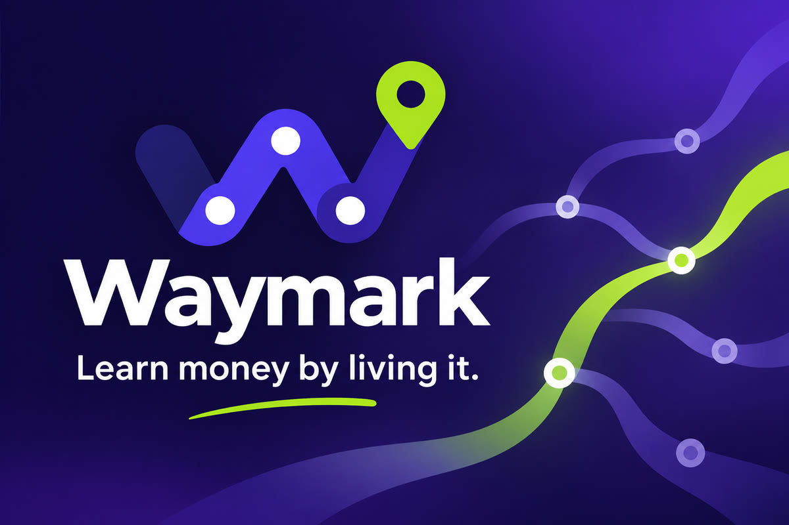
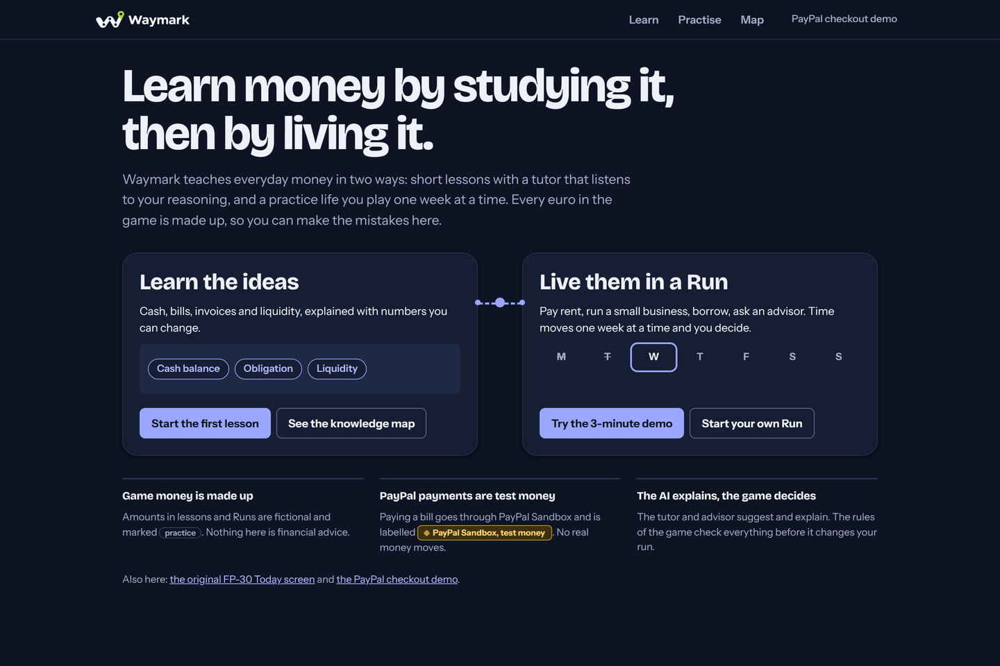
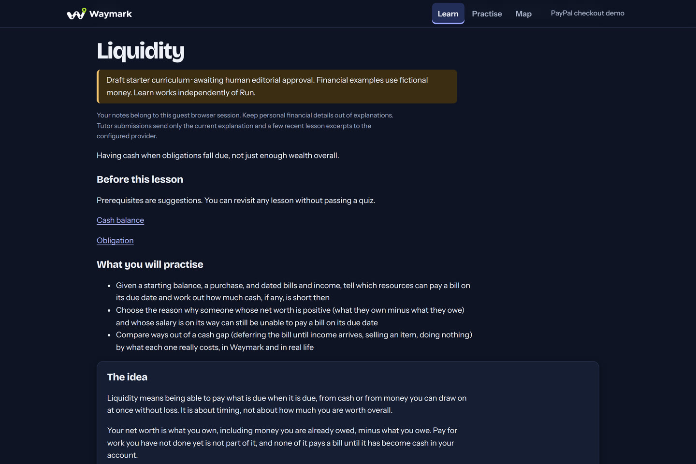
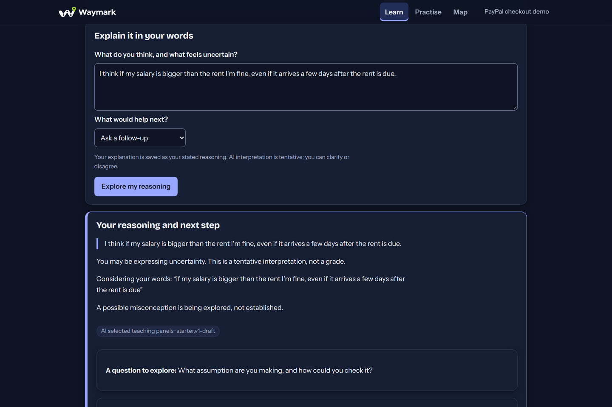
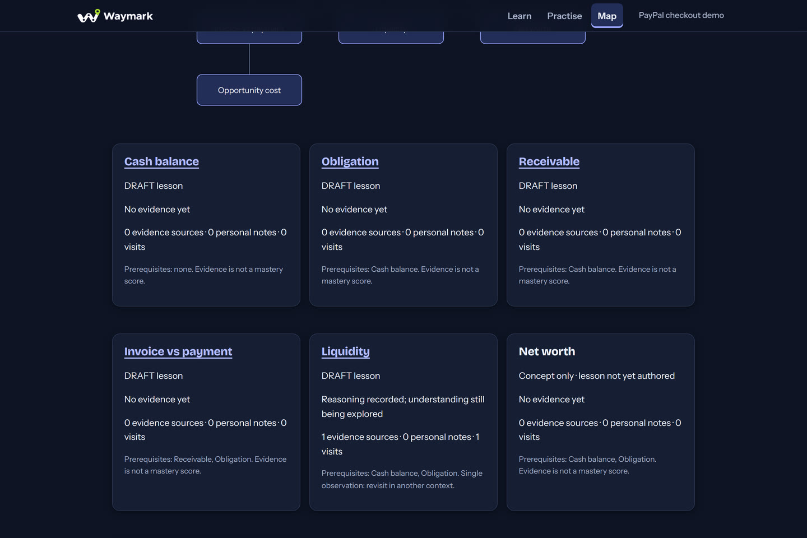
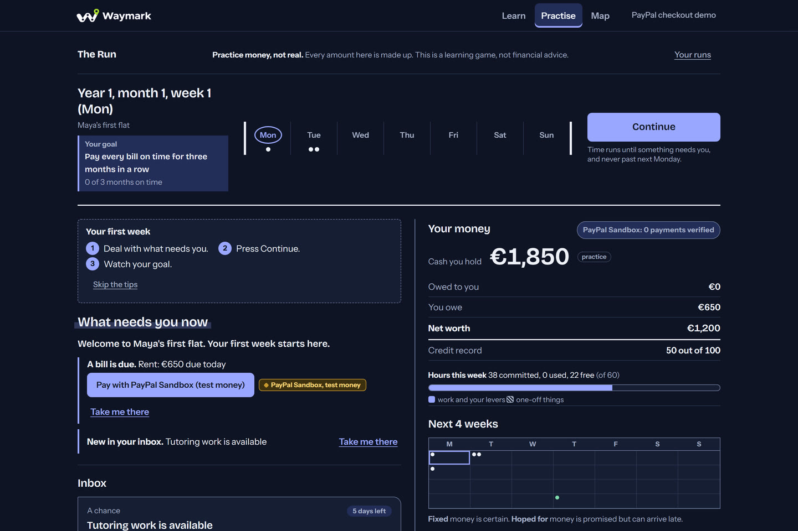
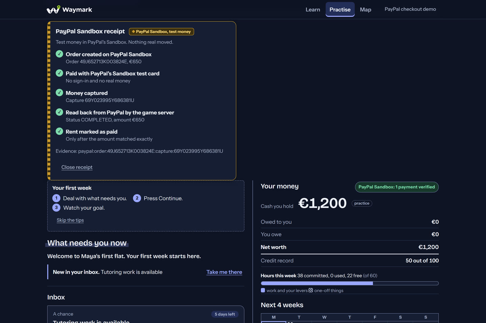

<p align="center">
  
</p>

# Waymark

**Learn money by studying it, then by living it.** Waymark combines a standalone financial curriculum with a practice life you play one week at a time.
- **Learn:** explain your reasoning, ask for another explanation, change a numerical example, practise, save personal notes and revisit a concept map.
- **Run:** make decisions about bills, work and a small business; inspect their consequences and follow concept links back to Learn.
- **PayPal Sandbox:** selected payments use a real Sandbox API integration. The server verifies a matching completed capture before settling a bill, using durable reservations, idempotency and reconciliation.

Simulation amounts are **fictional**. PayPal payments are **Sandbox test money**; Live payments are disabled. This is educational software, not financial advice or a bank. Starter curriculum content remains **DRAFT**, pending editorial approval. AI interpretations of reasoning are tentative evidence, never proof of mastery.

<p align="center">
  <a href="docs/release/judge-demo.md"><b>Judge demo</b></a> ·
  <a href="#a-quick-tour">Tour</a> ·
  <a href="#how-a-paypal-sandbox-payment-works">PayPal Sandbox flow</a> ·
  <a href="#run-locally-without-api-credentials">Run locally</a> ·
  <a href="#architecture-and-tools">Architecture</a> ·
  <a href="#current-limitations">Limitations</a>
</p>

## A quick tour

Screenshots from the integrated release build, in a guest session with fictional money and PayPal Sandbox test money. The curriculum shown is **DRAFT**.

<table>
  <tr>
    <td width="50%"><br><b>Two paths.</b> Study an idea, then live it in a Run.</td>
    <td width="50%"><br><b>Lessons.</b> Short, numeric and labelled DRAFT until editorial approval.</td>
  </tr>
  <tr>
    <td><br><b>An AI tutor that reads your reasoning.</b> It quotes you exactly, treats a possible misconception as tentative and chooses reviewed teaching panels.</td>
    <td><br><b>Knowledge map.</b> Evidence of what was observed, never a mastery score.</td>
  </tr>
  <tr>
    <td><br><b>A Run.</b> A money life one week at a time: bills, offers, hours and a four-week outlook.</td>
    <td><br><b>PayPal Sandbox receipt.</b> Rent settles only after the server reads back a matching completed capture.</td>
  </tr>
</table>

## How a PayPal Sandbox payment works

1. In a Run, the player chooses **Pay with PayPal Sandbox** on a due bill. The server holds that amount in the Run so nothing else can spend it while the payment is in progress.
2. The server creates an order through PayPal's Sandbox Orders API and pays it with PayPal's published Sandbox test card, so no buyer login or card details are needed.
3. The server captures the order, then reads the capture back from PayPal.
4. The bill is marked paid only when that capture is `COMPLETED` and its amount and currency match the bill exactly. Each capture can settle at most once.
5. The receipt shows the PayPal order and capture references. Payment records and the Run history are stored durably, and restarts or lost responses are reconciled against PayPal rather than guessed.

Setup and safety details are in [Optional PayPal Sandbox checkout](#optional-paypal-sandbox-checkout).

## Try the release candidate

[Judge demo and setup instructions](docs/release/judge-demo.md) describe the Learn → Run → PayPal Sandbox → Learn journey, keyboard access and a local alternative. A hosted release-candidate URL is pending deployment verification; an older hosted build must not be treated as the current demo.

The integrated candidate is `c48d23687d0951a1c41bf48a4415148da5c07f71`. Its [acceptance evidence](https://github.com/Philipjj609/waymark/issues/140#issuecomment-6796137800) records production-build browser tests, real PostgreSQL tests and actual Sandbox payments, including restart and lost-response recovery. A local passing test does not claim a hosted deployment has been verified.

## Run locally without API credentials

Requirements: **Node.js 24+**, Git and **pnpm 11.6.0**. The lockfile pins dependencies. Enable Corepack if your Node installation includes it, or install the pinned pnpm version separately.

```sh
git clone https://github.com/Philipjj609/waymark.git
cd waymark
corepack enable
pnpm install --frozen-lockfile
```

Before repository publication, cloning requires access to the private repository. Create a gitignored `.env` in the repository root with this credential-free development configuration:

```dotenv
WORLD_STORE=memory
AI_PROVIDER=fake
WAYMARK_RUN=1
WAYMARK_PAYPAL=0
APP_BASE_URL=http://localhost:3000
APP_ORIGINS=http://localhost:3000
```

```sh
pnpm dev
```

Open [localhost:3000](http://localhost:3000). Start at `/learn` or choose **Practise** for `/run`. The deterministic tutor stand-in is visibly labelled; it makes no model calls. In this mode, learning records and Runs are held in process memory and are lost when the server stops. Browser storage alone cannot recover a lost server record. PayPal is unavailable in memory mode; bills can be paid with fictional game cash.

The broader [`.env.example`](.env.example) documents optional provider settings; its values are placeholders, not usable credentials. Process environment variables take precedence. A linked worktree without its own `.env` reads the main checkout's `.env`, so use an explicit per-worktree configuration when isolating a demo.

## PostgreSQL and production-like configuration

Use an isolated **PostgreSQL 17** database you control. Configure `WORLD_STORE=postgres` and `DATABASE_URL` privately; do not point local tests at a production database. Learn records, canonical Run history and the shared payment records then persist across application restarts.

For a local database with Docker, first set a private `POSTGRES_PASSWORD` in your shell, then run:

```sh
docker run --name waymark-dev-db -e POSTGRES_USER=waymark -e POSTGRES_DB=waymark -e POSTGRES_PASSWORD -p 127.0.0.1:5432:5432 -d postgres:17
```

Set `DATABASE_URL` in `.env` using that local user's connection string and password. Use a fresh database name/container if `waymark-dev-db` already exists; do not overwrite another database. A connection password containing URL-reserved characters needs URL encoding.

The migration CLI reads the shell's `DATABASE_URL`, not `.env`. Export the same private local connection string in your shell before migrating (PowerShell uses `$env:DATABASE_URL`; POSIX shells use `export DATABASE_URL`). Do not paste it into logs or shared command transcripts.

```sh
pnpm db:migrate
pnpm --filter @fle/web build
pnpm --filter @fle/web start
```

Keep `APP_BASE_URL` and `APP_ORIGINS` set to the exact browser origin. Outside development, Run also requires a private, stable `RUN_SECRET` of at least 32 characters. Generate it securely; never use an example or development key. Changing it can invalidate saved pointers and the Run's derived seed. `SESSION_SECRET` is currently unused: guest identity comes from an opaque session cookie, with only its hash stored server-side.

The production entry point is one Next.js Node application. On HTTPS, the guest cookie is Secure, HttpOnly and SameSite=Lax. Data belongs to that browser session; there is no account-based or cross-device recovery. Preserve the cookie and Run pointer when revisiting. `/api/health` checks application liveness, not database or provider readiness.

### Optional Nebius tutor

Set `AI_PROVIDER=nebius`, a private `NEBIUS_API_KEY`, `NEBIUS_API_BASE=https://api.tokenfactory.nebius.com/v1` and an available `AI_MODEL_TUTOR` (the configured project model is `openai/gpt-oss-120b`). Keep structured outputs enabled and the bounded token settings from `.env.example`. `pnpm nebius:check` probes the provider; it makes real API calls and may consume your existing quota.

Responses are schema-validated and grounded in curriculum facts. Financial arithmetic and exercise grading run deterministically. Model failure, invalid output or timeout produces a labelled fallback; a fallback is not evidence of a successful model response. Do not put sensitive personal information into reasoning or notes.

### Optional PayPal Sandbox checkout

Durable checkout requires PostgreSQL, existing **Sandbox app** credentials in the server's secret environment, and these flags:

```dotenv
WAYMARK_PAYPAL=1
PAYPAL_ENV=sandbox
PAYPAL_API_BASE=https://api-m.sandbox.paypal.com
PAYPAL_SANDBOX_TEST_CARD=1
```

The Run demo uses PayPal's published Sandbox test-card path server-side, so judges need no buyer login or card details. `PAYPAL_CLIENT_ID` and `PAYPAL_CLIENT_SECRET` are operator secrets, never browser configuration. `pnpm paypal:check` checks Sandbox access without printing credentials. Never substitute Live credentials or a Live API endpoint.

Set the callback origin to the same exact allowed app origin. The separate `/checkout` demonstration also supports approval/return handling; a redirect or HTTP success does not settle a payment. Webhook registration is a separate operational step and must not be assumed from a working checkout. See [payment evidence](docs/payments/d1b-app-evidence.md), [shared checkout design](docs/adr/0014-shared-checkout-targets.md) and the release acceptance evidence above.

Apply migrations in order, including `0003_personal_learning` → `0004_run_heads` → `0005_payment_targets`, before enabling Run payments. Back up an existing database first. Preserve captured associations and append-only history during rollback; do not run an older World-only payment worker against Run jobs. Deployment and schema rollback need the release runbook and owner approval.

## Tests

```sh
pnpm verify                  # lint, typecheck, tests and generated-contract drift
pnpm --filter @fle/web exec playwright install chromium
pnpm e2e                     # production build, then real browser regression suite
pnpm demo                    # original fictional FP-30 engine trace
```

Ordinary browser tests pin memory storage and the fake AI provider; they make no PayPal or Nebius calls. The original FP-30 trace is an engine regression example, not the definition of the Run experience.

For PostgreSQL integration tests, privately set `TEST_DATABASE_URL` to an **isolated local test server** whose role can create and drop test databases, then run `pnpm test --maxWorkers=4`. Never use production credentials. Without this variable, the real-PostgreSQL portions are skipped; PGlite coverage alone does not establish PostgreSQL concurrency behavior.

Actual provider/browser acceptance is explicit opt-in and uses separate test configurations. Consult the acceptance evidence and harness safety guards before enabling it; do not run a live-provider probe accidentally or supply shared production data. CI also scans reachable Git history with Gitleaks and runs a dependency vulnerability audit. See [SECURITY.md](SECURITY.md).

## Architecture and tools

| Area                   | Implementation                                                                                |
| ---------------------- | --------------------------------------------------------------------------------------------- |
| Web application        | Next.js App Router, React and TypeScript; guest sessions and server-owned commands            |
| `packages/contracts`   | Zod wire schemas and generated JSON Schema                                                    |
| `packages/domain`      | Integer minor-unit money and balanced, immutable double-entry journals                        |
| `packages/run`         | Deterministic Run rules, replay and view models                                               |
| `packages/simulation`  | Original World engine, command idempotency and deterministic replay                           |
| `packages/learning`    | Shared curriculum, prerequisites, evidence model and typed teaching components                |
| `packages/ai`          | Grounded Nebius tutor adapter, validated structured responses and safe fallbacks              |
| `packages/payments`    | Sandbox-only PayPal HTTP client and verified provider observations                            |
| `packages/server`      | Application services and target-neutral payment orchestration                                 |
| `packages/persistence` | PostgreSQL/Drizzle adapters, atomic operations, append-only Run history and migrations        |
| Verification           | Vitest, fast-check, PGlite, PostgreSQL, Playwright, Biome and Gitleaks                        |
| Hosting                | Render Blueprint for the Node application and PostgreSQL; deployment is an explicit operation |

The AI proposes explanations; deterministic code owns economic truth. World and Run share one authoritative payment operation/work/fact stream. Receipts are projections, not a second settlement store. Concept connections and learning evidence are separate from mastery: neither a graph edge, an economic win nor a single answer proves understanding.

## Current limitations

- Curriculum and sources remain DRAFT pending editorial review; this is not a validated financial course.
- Guest sessions have no account recovery. Losing the cookie or browser Run pointer can remove access even when server data remains durable.
- Memory mode is ephemeral. Persistence guarantees require PostgreSQL and a stable Run secret.
- AI can fail or misunderstand; learners can clarify or disagree. The knowledge map uses conservative evidence labels, not calibrated mastery scores.
- PayPal is Sandbox-only. Hosted callback configuration and webhook registration require separate verification; no Live payment support is offered.
- Browser regression coverage is Chromium-based, including narrow viewports. It is not a complete accessibility audit or real-device/cross-browser certification.

## Contributing and licensing

Read [AGENTS.md](AGENTS.md), [CONTRIBUTING.md](CONTRIBUTING.md) and [SECURITY.md](SECURITY.md) before contributing. Architecture decisions live in [docs/adr](docs/adr); GitHub issues are the task and handoff source of truth.

The Waymark name, logo and README artwork identify the project. The code licenses below do not grant trademark rights (see Apache-2.0 section 6).

Project-authored code is offered under [MIT](LICENSE-MIT) **OR** [Apache-2.0](LICENSE-APACHE), at your option. Third-party dependencies, fonts, assets and source material retain their own licenses and attribution requirements; the root license does not relicense them. See [third-party notices](THIRD_PARTY_NOTICES.md), also available in plain text at `/third-party-notices.txt`, and the [license-template provenance review](docs/release/graphrag-provenance.md). Publication retains its separate review and owner-authorization gates. No code from the AGPL-licensed `learnharness` reference is included by design; its architecture informed research only.
