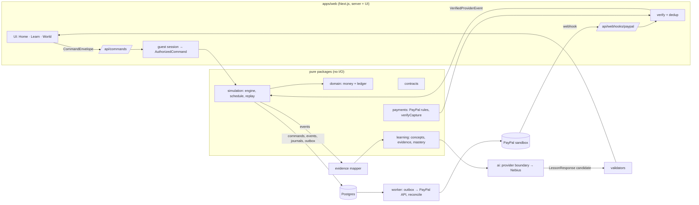

# Architecture overview (RFC-001)

Status: **v0.1, 2026-11-06, lead recommendation.** Decided parts link to ADRs; open parts are marked **OPEN**.
Sources reconciled: Drive SIM-001/002/003, ECO-010/011/020/021/022, OPP, DIR-001, BRG-001, LEARN-001/2/3,
UX-001/2/3, VIS-000, ARCH-000, ENG-000 (register: `docs/reconciliation/2026-11-06-design-reconciliation.md`).

## 1. The one rule that shapes everything

> **Deterministic code owns economic truth. AI interprets, teaches and proposes. PayPal sandbox is an external,
> verified fact source for selected mapped events, never the in-game wallet.**

## 2. Modules and boundaries

| Package           | Owns                                                                            | Must never                                    |
| ----------------- | ------------------------------------------------------------------------------- | --------------------------------------------- |
| `contracts`       | wire shapes + versioning                                                        | contain logic beyond validation               |
| `domain`          | money arithmetic, posting rules, statements, consolidation                      | do I/O, know about worlds or UI               |
| `simulation`      | world state machine, commands, schedule, determinism, replay                    | call networks, clocks, models                 |
| `payments`        | PayPal status mapping, exact amounts, verification rules; later the HTTP client | mutate the ledger directly                    |
| `learning`        | concept graph, evidence, learner state, assessment rules                        | read or write money                           |
| `ai` _(WP)_       | model adapters, prompts, structured output, repair/fallback                     | be trusted without validators                 |
| `apps/web` _(WP)_ | auth/session, HTTP, persistence adapter, UI                                     | compute authoritative balances in the browser |

## 3. Write path (one command)

1. Client sends `CommandEnvelope` (`sim.command.v1`) with `expectedWorldVersion` and a fresh `commandId`.
2. Server parses with zod, derives `actorId` + `origin` from the session → `AuthorizedCommand`.
3. Load world → `execute()` → new state + events + journals, or a coded rejection.
4. **One DB transaction:** insert command result (unique `command_id`), events, journals; update
   `worlds.version WHERE version = expected`; enqueue outbox. Conflict → `STALE_WORLD_VERSION`.
5. Respond with `CommandResult` + fresh `WorldSnapshot`.

## 4. PayPal path (ADR-0008)

Create order (server, `PayPal-Request-Id`) → buyer approves (sandbox account) → server capture → server
re-reads order → `verifyCapture()` → `APPLY_VERIFIED_PROVIDER_EVENT` (origin VERIFIED_EXTERNAL) → obligation
settled once. Webhooks feed the same verification; dedup by provider event id. Until verified, UI shows
**PENDING (SANDBOX)**. A late confirmation is applied at the current world day (external result = input, I-007).
**OPEN:** earmark cash at checkout start (recommended) so a late capture can never overdraw fictional cash.

## 5. Learning path

Engine events → evidence mapper → `EvidencePacket` (facts + possible concepts, never verdicts) → learner
state (evidence with basis observed/stated/inferred) → planner picks objective → lesson from reviewed content,
optionally adapted by the model inside frozen facts → validators (schema, recomputed numbers, recipe whitelist,
sources) → `LessonResponse` → typed renderer. Transfer checks use a different surface story.
**OPEN:** mastery method (start rule-based with explicit uncertainty; BKT later if data supports it).

## 6. Cross-cutting

- **Identity/naming:** `config/project-identity.json` (GOV-001 mirror). No codename in ids, tables or events.
- **Security:** see `SECURITY.md`. Tenant isolation by session-owned worlds. Teens ⇒ no personal data (ADR-0011).
- **Observability (P1/P3):** structured logs with `worldId`, `commandId`, `operationId`; no secrets or PII.
  Every journal links to its causal event, so "why did this happen?" is a query, not a log search.
- **Determinism:** the head hash of a world is reproducible from config + authorized command log.

## 7. What we deliberately did not build

No microservices, no message broker, no separate API service, no ORM entity graph of the economy,
no model-generated UI code, no "all money through PayPal". Each can be revisited with a measured need.
