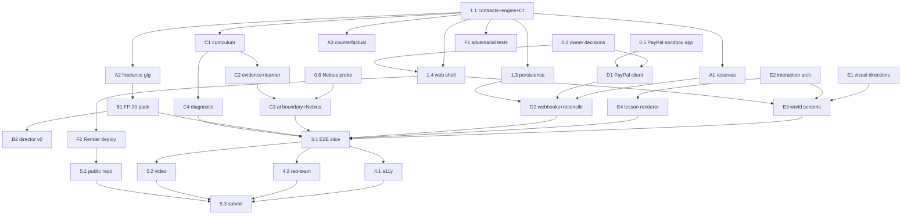

# Roadmap: phases, subphases, gates and dependency graph

Status: v0.1, 2026-11-06. The **board is the live view**; this file explains the structure. Issue numbers
are on the board (`WP` ids below are stable names used in issue titles).
Hard date: Devpost submission closes **Thu 12 Nov 2026, 12:00 PT** (20:00 UTC). Internal target: submit by
**09:00 PT** on 12 Nov.

## Phases at a glance

| Phase                     | Window (2026) | Goal                                                                           | Exit gate (OPS-000)                                              |
| ------------------------- | ------------- | ------------------------------------------------------------------------------ | ---------------------------------------------------------------- |
| P0 Discovery & governance | 5–7 Nov       | inventory, reconcile, decisions, rules verified                                | **G0** conflicts listed, owner decisions recorded                |
| P1 Engineering foundation | 6–7 Nov       | repo, contracts, ledger, engine, CI, security baseline, persistence, web shell | **G1** contracts accepted, fixture green, CI on PRs              |
| P2 Parallel development   | 7–10 Nov      | six workstreams against frozen contracts                                       | **G2** each module's contract tests pass independently           |
| P3 Integration            | 9–11 Nov      | one end-to-end slice incl. real PayPal sandbox + grounded lesson               | **G3** verified sandbox flow, idempotent; correct ledger mapping |
| P4 Expansion & quality    | 10–11 Nov     | more mechanisms, a11y, red-team, polish                                        | **G4** fresh-user E2E + recovery journey, accessible             |
| P5 Release                | 11–12 Nov     | deploy, public repo, video, submission                                         | **G5** security, license, docs, deploy, submission verified      |
| P6 Long term              | after 12 Nov  | full product roadmap                                                           | per-epic                                                         |

## Subphases and work packages

**P0** — 0.1 discovery report ✅ · 0.2 owner decisions (hosting, PayPal meaning, sessions) · 0.3 team/agent
registry and acknowledgments · 0.4 reconciliation sign-off · 0.5 PayPal sandbox app + accounts (owner) ·
0.6 Nebius account probe.

**P1** — 1.1 contracts + domain + engine + CI (**this bootstrap PR**) · 1.2 repo protection + labels + board ·
1.3 persistence adapter (ADR-0005) · 1.4 `apps/web` shell + guest session + `/api/commands` · 1.5 secret
scanning + dependency review.

**P2** (parallel tracks, each with its own DRI)
- **A Economy:** A1 reserves/earmarks + partial settlement · A2 freelance gig lifecycle (agreement → work →
  receivable → invoice → collection, seeded payment timing) · A3 counterfactual fork + compare.
- **B Scenario:** B1 FP-30 scenario pack (≥6 event patterns, 2 viable strategies, recovery) · B2 Director v0
  (template catalog + candidate validator + pacing).
- **C Learning/AI:** C1 reviewed starter curriculum (sources, objectives, exercises) · C2 evidence mapper +
  learner state · C3 `@fle/ai` boundary + Nebius adapter + validation/fallback · C4 diagnostic onboarding.
- **D Payments:** D1 PayPal HTTP client + sandbox smoke · D2 webhook verification + outbox reconciliation.
- **E UX/visual:** E1 three visual directions → owner pick · E2 interaction architecture + components ·
  E3 World screens · E4 lesson renderer + visual recipes.
- **F QA/infra:** F1 adversarial matrix T01–T22 as code · F2 Render deploy (preview + prod).

**P3** — 3.1 E2E slice (Playwright): guest → diagnostic → FP-30 → due bill → PayPal sandbox → verified
settlement → contextual lesson → transfer question · 3.2 contract reconciliation + merge-order review.

**P4** — 4.1 accessibility audit + fixes · 4.2 economy/UX red-team + real-tester walkthrough (no invented quotes).

**P5** — 5.1 public repo + license + judge README (owner approval) · 5.2 demo video < 3 min (YouTube) ·
5.3 Devpost submission + checklist.

**P6** — business entity in the engine (ECO-021 end to end), loans/amortisation, investments with lots,
locale tax packs with reviewers, accounts + age policy, languages, Director learning from pacing data.

## Dependency graph

## What can run concurrently right now (after this PR merges)

Independent: **A1, A2, A3, C1, E1, E2, F1, 1.3, 1.4** (different packages/files). **D1** needs sandbox
credentials (0.5). **C3** needs a Nebius key (0.6). **E3/E4** need E1/E2 and fixtures from `snapshot()`.
Shared-file hot spot: `packages/contracts` — only via `contract-change` issues, merged one at a time.

## Scope guard for the deadline

Must for submission: 3.1 slice working end to end with one verified sandbox capture and one validated lesson;
deploy or clear run instructions; video; public repo. Everything else is ranked on the board and may slip to P6
without breaking the architecture.

## Vertical slice v1 (critical path after #37 merges)

Goal: **browser → guest session → persistent economy → decision → contextual AI learning → verified sandbox payment → consequence**,
with the full architecture intact (every step goes through the real contracts, engine and verification).

| Step                                              | Issue | Prerequisite                     | Parallel with                     |
| ------------------------------------------------- | ----- | -------------------------------- | --------------------------------- |
| Persistence adapter (event store, outbox, PGlite) | #9    | #37                              | #10, #12, #13, #17, #23, #24, #27 |
| Web shell + guest session + `/api/commands`       | #10   | #37 (decisions recorded in #2)   | #9                                |
| Reservation lifecycle (contract-change)           | #12   | #37                              | #9, #10                           |
| PayPal sandbox client + checkout                  | #21   | #12, #5 (sandbox credentials)    | #18                               |
| Webhooks + reconciliation worker                  | #22   | #21, #9                          | #19                               |
| Evidence bridge + learner state                   | #18   | #17                              | #21                               |
| AI boundary + Nebius + validators                 | #19   | #18, #6 (key + capability probe) | #22                               |
| World screens (minimal, on chosen direction)      | #25   | #23, #24, #10                    | #19, #22                          |
| Lesson renderer                                   | #26   | #24                              | #25                               |
| E2E slice                                         | #29   | all of the above                 | —                                 |

Merge order for the slice: #9 → #12 → #10 → #21 → #22, while #17 → #18 → #19 and #23/#24 → #25/#26 run in parallel.
